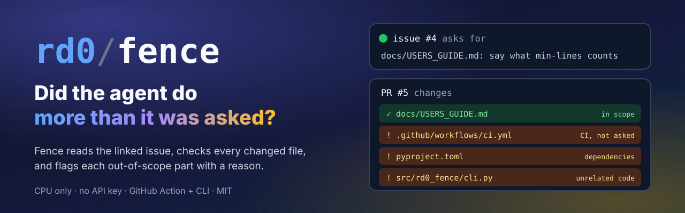
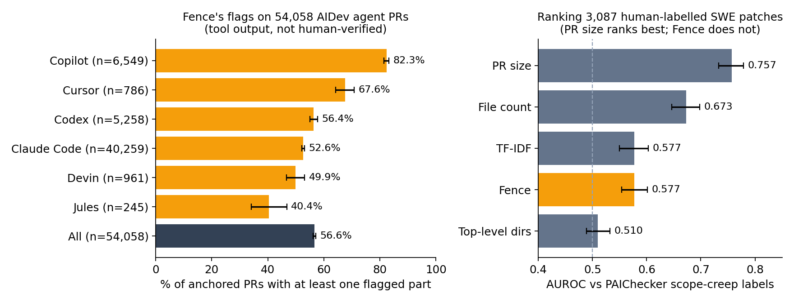

<p align="center">
  
</p>

<p align="center">
  <b>Fence flags the parts of a coding-agent PR that go beyond what its issue asked for.</b><br>
  <sub>The third tool in <b>rd0</b> — review debt, to zero. Siblings: <a href="https://github.com/ReviewDebtZero/rd0-jinx">Jinx</a> (duplicate PRs) and <a href="https://github.com/ReviewDebtZero/rd0-trellis">Trellis</a> (agent rules into checks).</sub>
</p>

<p align="center">
  <a href="https://github.com/ReviewDebtZero/rd0-fence/actions/workflows/ci.yml"></a>
  <a href="LICENSE"></a>
  
  
  
  <a href="action.yml"></a>
  <a href="https://huggingface.co/datasets/hao-li/AIDev"></a>
  <a href="https://rd0-fence.netlify.app"></a>
</p>

Coding agents often do a little more than asked: a CI tweak, a dependency bump, a reformatted function, a
"while I was here" edit in another module. Reviewers catch these by reading the issue and then every changed
file. Fence does that comparison for them and leaves one comment listing each out-of-scope part and why.

## See it work

<table>
  <tr>
    <td width="50%" align="center">
      <a href="https://rd0-fence.netlify.app/fence_demo.mp4">
        
      </a>
      <sub>Real CLI run and real Action comment (<a href="https://github.com/ReviewDebtZero/rd0-fence/pull/5">PR #5</a>). Click for the full video.</sub>
    </td>
    <td width="50%" align="center">
      <a href="#research">
        
      </a>
      <sub>Left: Fence's own flags on 54,058 AIDev PRs (not human-verified). Right: plain PR size beats Fence on PAIChecker's labels.</sub>
    </td>
  </tr>
</table>

> Status: the CLI and Action work. Fence's precision is not measured yet: a 300-PR gold sheet is ready but has no
> human labels. The prevalence numbers below are Fence's own flags, and on PAIChecker's human scope-creep labels
> plain PR size (AUROC 0.757) ranks scope creep better than Fence (0.577).

## Try it

```bash
pip install ./packages/rd0-fence
fence check --issue packages/rd0-fence/examples/issue.md --diff packages/rd0-fence/examples/pr.diff
```

```text
fence: 4 part(s) outside the issue's scope, 13/22 changed lines (59%)
  [low] utils/text.py @@ +23 def truncate(value, n): (+/-4): formatting-only edit (same tokens, new whitespace)
  [high] utils/dates.py (+/-6): edits a code file (changes `parse`) that no path, name or term in the issue points to
  [high] .github/workflows/ci.yml (+/-2): changes CI or workflow config; the issue never mentions CI
  [high] requirements.txt (+/-1): changes dependencies or package metadata; the issue does not ask for that
```

Check a real PR against the issue it closes (set `GITHUB_TOKEN` for private repos or higher rate limits):

```bash
fence github owner/repo#123            # issues from "Fixes #N" in the PR body
fence github owner/repo#123 --issue-number 45 --format markdown
```

## How it decides

Fence reads the issue for file paths, directories, code names (`snake_case`, `CamelCase`, dotted, backticked)
and plain terms, then labels every changed file:

| In scope when | Out of scope when |
|---|---|
| the issue names the file, its directory, or a name the hunk defines or uses | nothing in the issue points to the file |
| it is the test for an in-scope file, or it imports an in-scope file | it is CI, a dependency manifest or lockfile, and the issue never asks for that |
| it shares issue terms (title terms count double) | a hunk only changes whitespace (formatting-only) |

If the issue names nothing concrete, Fence says scope is unknown and only judges CI, dependency and formatting
parts. Output: a scope-reach score (out-of-scope changed lines / all changed lines), every part with a reason,
as text, JSON or a Markdown PR comment.

## GitHub Action

```yaml
on:
  pull_request_target:
    types: [opened, reopened, synchronize, edited]
permissions:
  contents: read
  pull-requests: write
  issues: write
jobs:
  fence:
    runs-on: ubuntu-latest
    steps:
      - uses: ReviewDebtZero/rd0-fence@main
```

It reads the PR, its linked issue and the changed files through the GitHub REST API, posts or updates one comment,
and never runs PR code. Inputs: `issue` (override the linked issue), `min-lines` (comment only above this many
out-of-scope lines). See [docs/USERS_GUIDE.md](docs/USERS_GUIDE.md).

## Research

- [Dataset survey](research/docs/dataset_survey.md): Hugging Face and literature, with measured sizes.
- [Experiment design](research/docs/experiment_design.md): the scope-reach metric, gold sheet and baselines.
- [Feasibility](research/experiments/feasibility/): 69,157 of 361,296 AIDev-pop agent PRs (19.1%) link an issue
  with usable text; 68,192 of those have diff rows.
- [Benchmark](research/experiments/benchmark/): Fence and four baselines on the 54,058-PR AIDev corpus, plus a check
  against PAIChecker's human scope-creep labels. Measured so far, all from Fence's own output:
  - 2,361 PRs (4.4%) name nothing concrete, so Fence marks their scope unresolvable.
  - Of the rest, 56.6% [56.2, 57.1] have at least one flagged part and 44.8% [44.4, 45.3] a high-severity one
    (95% Wilson CIs). By agent the share runs from 40.4% (Jules) to 82.3% (Copilot); Copilot's PRs touch more files,
    so this is not a ranking of agents.
  - On 3,087 PAIChecker instances, AUROC is 0.757 for PR size, 0.673 for file count, 0.577 for Fence and for TF-IDF
    similarity, and 0.510 for top-level directories. PR size wins.
- [Gold sheet and labeling app](research/experiments/label_audit/): 300 PRs (50 per agent), 1,471 files, labelled per
  file; no human results yet.

## Layout

```
packages/rd0-fence/   Python package and `fence` CLI (stdlib only)
action.yml            composite GitHub Action
research/             dataset survey, experiment design, feasibility script and results
docs/                 user guide
web/                  Next.js static site for Netlify (numbers come from web/src/data/fence.json)
assets/               banner, benchmark chart, demo GIF; assets/video/ has the video sources
```

MIT licensed. Data from AIDev (hao-li/AIDev, CC BY 4.0).
